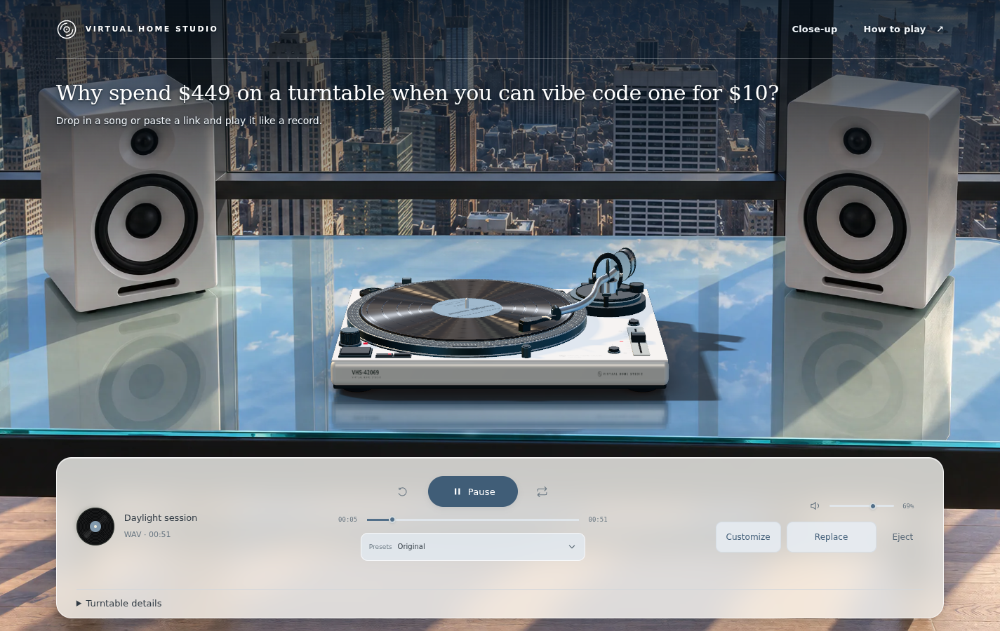
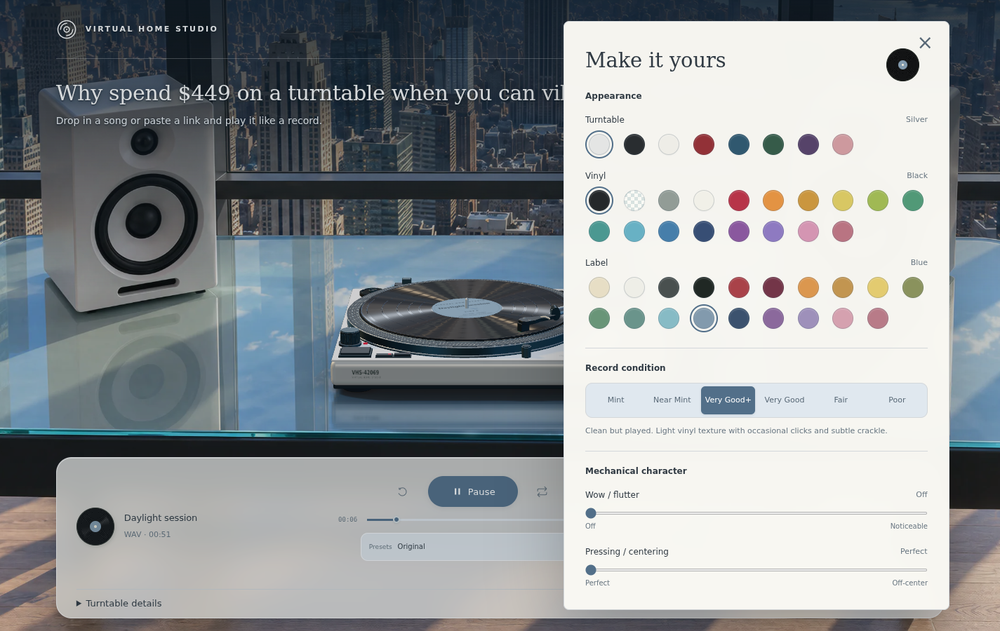

# Virtual Home Studio

> [!NOTE]
> **Your music stays on your device.** Selected MP3/WAV files are decoded and played entirely in your browser. The app does not upload your music to GitHub or another server.
>
> The hosted version uses GitHub Pages over HTTPS. The deployment publishes only the website's HTML, CSS, JavaScript and assets; you do not need to run a server or create an account to listen.
>
> GitHub logs visitors' IP addresses for security purposes, so local audio processing does not mean anonymous browsing. See [GitHub's data collection disclosure](https://docs.github.com/en/pages/getting-started-with-github-pages/what-is-github-pages#data-collection).

> This is 100% vibe coded and I did this because I didn't want to buy a turntable for my home lab lol.

Why spend $449 on a turntable when you can vibe code one for $10?

Choose an MP3 or WAV, or drop one onto the deck and play it like a record.



Meet the VHS-42069, a fictional direct-drive turntable in a daylight Manhattan home studio. Select the deck or **Close-up** to move closer (the dust cover lifts as you approach); choose **Back to studio** or press **Escape** to pull back and it closes again. Your record keeps playing throughout. Audio stays local.

## Quick start

Requires Python 3.11+, [uv](https://docs.astral.sh/uv/), and a modern browser. Run from the project directory:

```sh
uv sync
uv run python app.py
```

Open **http://127.0.0.1:42069**. Stop the server with Ctrl+C.

## GitHub Pages

The app also runs as a static HTTPS site; Python is only needed for the local server.

1. In the repository's **Settings → Pages**, set **Build and deployment → Source** to **GitHub Actions**.
2. Merge the deployment changes into `master`. The included [Pages workflow](.github/workflows/pages.yml) publishes automatically on pushes to `master`.
3. Watch **Actions → Deploy GitHub Pages**. If Pages was enabled after the merge, run the workflow manually on `master`.
4. Open **https://dilldylanpickle.github.io/virtual-home-studio/** after deployment succeeds.

The workflow publishes only the HTML and `static/` assets. Local music stays in each visitor's browser. Asset URLs work under the repository's URL prefix and on the local server. Keep a trailing slash on the site URL; ordinary static hosting should redirect directory URLs automatically.

## What it does

- A full-screen daylight Manhattan studio: a photoreal background plate of the room, monitors, glass table and skyline, with the live 3D turntable rendered into it. The software controls float over the scene, and the camera travels continuously into the turntable. Audio still never leaves your browser.
- MP3/WAV playback with assisted Play or manual tonearm control.
- **Choose Record / Replace Record** opens a compact source chooser. Pick **Local File**, or drag and drop an MP3/WAV anywhere on the page.
- A bright blue empty-state glow highlights where to begin, with a static highlight when reduced motion is enabled.
- Presets, dialogs and expandable details open and close smoothly; reduced motion keeps them immediate.
- 33⅓ / 45 / 78 RPM, pitch adjustment and Quartz lock.
- Vinyl scratching, direct scrubbing and audible motor transitions.
- Automatic BPM and beat detection (offline, cached per file) driving a beat-synced Trance Gate, with manual BPM, tap tempo, half/double time and grid nudging.
- Eight turntable finishes, vinyl/label colors, record condition, surface texture and cartridge character.
- Open **Customize** to change the chassis color, including Black, Red, and the default Silver. Colors stay selected through record changes within the session.

<details>
<summary>Turntable and record customization</summary>



</details>

## Controls

| Control | Action |
| --- | --- |
| Close-up / Back to studio | Header toggle between the room and close inspection; clicking the deck also moves closer. In close-up it becomes **← Back to studio** (Escape also works outside dialogs and drop previews) |
| Skyline / Back to studio | In the studio view, fade the controls and look out over the city while the music plays (Escape or a click also returns) |
| Hide / Show controls | In close-up, slide the slim listening bar away for a full view of the turntable, or bring it back |
| Graphics | In **Turntable details**. Cinematic by default; Balanced and Performance reduce rendering cost. Resolution steps down automatically if frames run late, but never below one device pixel per CSS pixel |
| Play / Pause | Cue automatically / hold your place, with the same spin-up and slowdown as START/STOP |
| Presets | Pick one of seven speed/pitch combinations, or Original to reset; the physical fader glides into place and the sound follows. The popup's right column holds Tempo and the beat-synced effects |
| BPM chip / Tempo | Each record is analyzed when it loads. The chip and Tempo show the BPM as it plays (speed buttons, presets and pitch raise or lower it) with a confidence dot; the chip opens the popup. If the gate sounds off the beat, **Tap the beat** (or press **T**) along with the music, or open **Fix the beat**: Half/Double, Exact BPM, Earlier/Later, Move by a beat, Reset |
| Trance Gate | Switch it on (or press **G**) and pick a style: **Push** (sidechain pump on every beat), **Pulse** (Push, chopped: a steady throb), **Bounce** (lighter double-time pump), **Breathe** (slow swell), **Trance** (16th shimmer) or **Gallop** (triplet lilt). Styles dip rather than drop out, with soft edges. Fine-tune shape (Chop / Pump), rate (1/2 to 1/32, 1/8T triplets), depth, gate length or swell, and the steps; edits become Custom. It follows the record's beats through seeks, pauses, scratches and speed changes, and never changes speed or pitch. Reverb is coming soon |
| Hardstyle | A synthesized hardstyle kit on the beat, tuned to the song's root. Pick the kick **Sound**: Euphoric, Rawstyle (harder, screechier), Techno drive (rumbling hard techno low end) or Gabber. Distorted kick, clap and open hat lanes, eight bars long like a DAW pattern: pick a bar to see and edit its 16 steps (the playing bar is ringed, bars with fills are dotted), or **Copy to all**. Kit presets (Classic, Anthem, Build, Gallop, Roll, Half time) add fills in bars 4 and 8, crashes every 4 or 8 bars, and the song ducking under the kick. **Drop it!** (or **D**) builds for a bar, pauses a beat and slams back in; **Random drops** does it on its own at phrase ends; **Air horn** for the drop. Volume, Distortion, Tail and Tune |
| Pixel Cat | Turns any song into an 8-bit remix: a chiptune band (pulse-wave melody with echo, NES-style triangle bass) plays along in the song's chords while **8-bit crunch** crushes the record. Pick a **Melody** (Bounce, Sparkle, Hop), switch **Nya vocals** on or off, and set the **Band** level |
| Repeat icon | Replay the current record after it finishes; click again to turn off |
| Tonearm / CUE | Drag to another groove / lift the stylus, or lower it on the damped cue (it touches down after about a second) |
| Vinyl | Drag with the stylus down to scratch; hold still to silence |
| Timeline | Hover to preview, click to seek, drag to scrub |
| 33 + 45 | Press both for 78 RPM |
| Pitch / Quartz | Adjust speed / lock to the selected nominal RPM |
| Return arm | Lift and park the arm; platter stays independent |
| Customize / Replace | Change the turntable finish and record’s look and sound / choose another file |

The source chooser also shows a grey, disabled **YouTube link — Coming soon** placeholder.

Open **How to Play** for the visual cheat sheet and keyboard shortcuts.

## Development

FastAPI serves plain HTML, CSS and JavaScript; there is no frontend build step. The studio uses locally bundled Three.js 0.180.0 under its [MIT license](static/vendor/THREE-LICENSE.txt), with WebGL 2 rendering. If WebGL is unavailable, the accessible SVG turntable remains usable. Chromium is the tested browser.

```sh
uv sync --group dev
uv run --group dev playwright install chromium
uv run --group dev python tests/acceptance.py
```

The 3D turntable benefits from hardware acceleration. Quality settings bound pixel ratio, shadows, reflections and multisampling. The studio background plates are generated from an unpublished master with `uv run tools/make-plates.py`. Headless software rendering can be substantially slower than an accelerated browser.

Keep the server running in another terminal. Acceptance checks also require `ffmpeg`; DSP tests require Node.js. See [AGENTS.md](AGENTS.md#tests) for the test catalog and development rules.

## More documentation

- [AGENTS.md](AGENTS.md): source map, architecture, invariants and testing.
- [REFERENCE.md](REFERENCE.md): hardware geometry and simulation assumptions.

The physical deck and sound are simulations, not calibrated hardware measurements.
