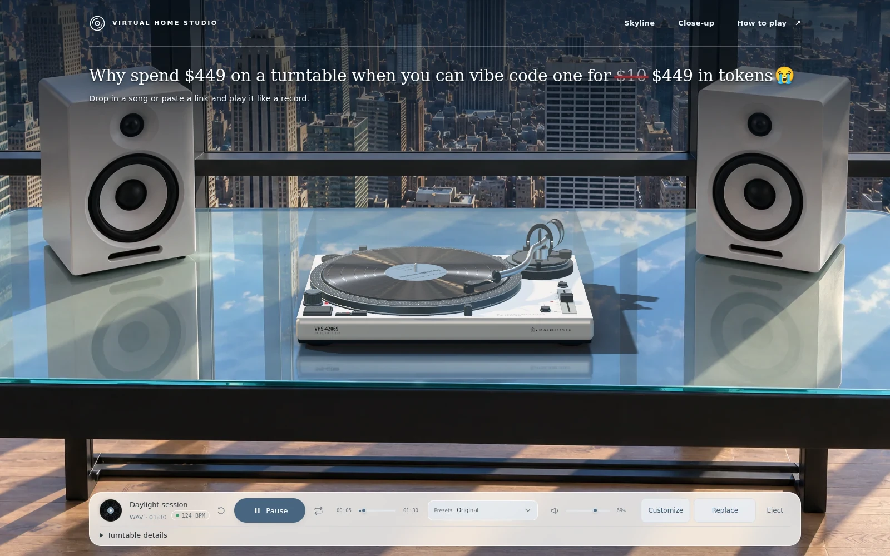
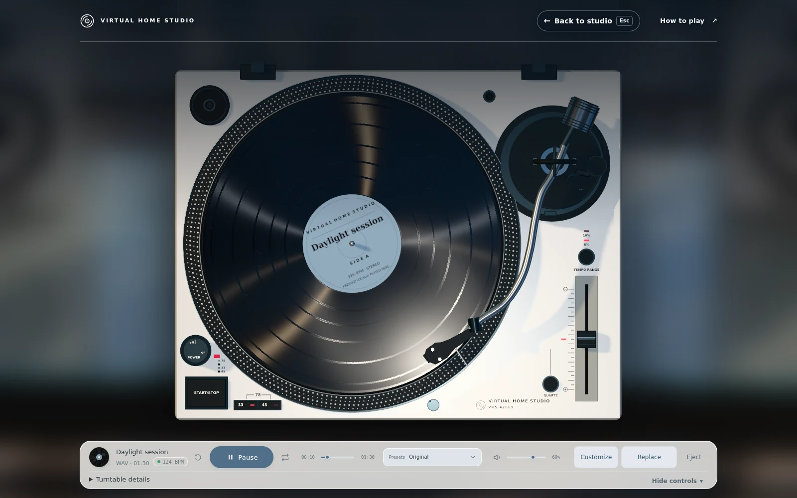
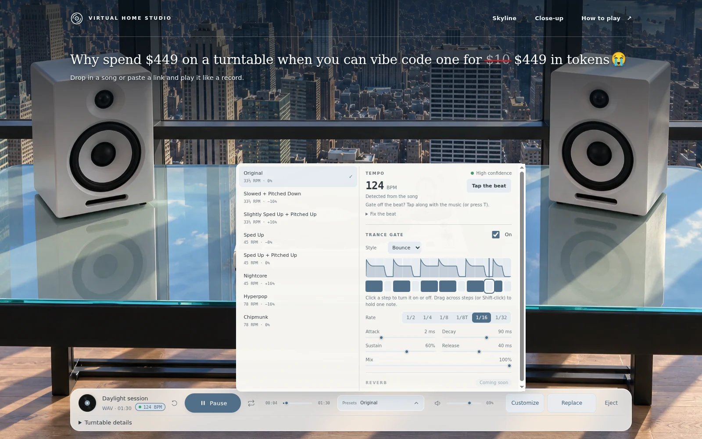
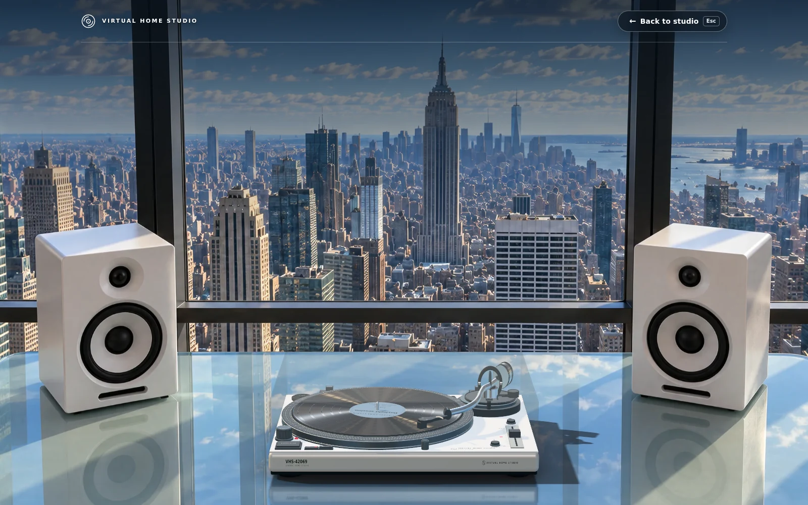
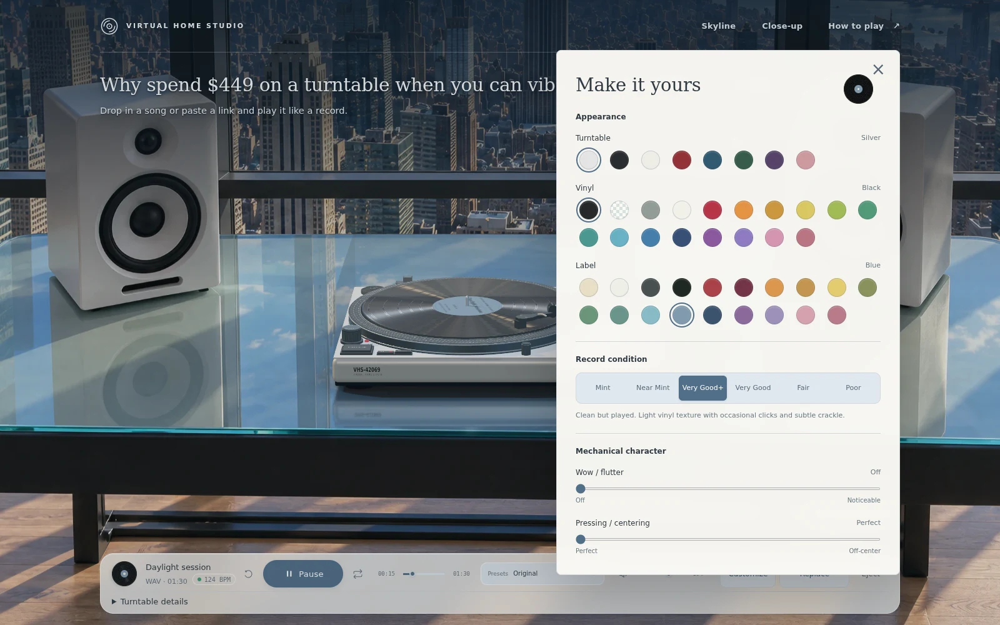
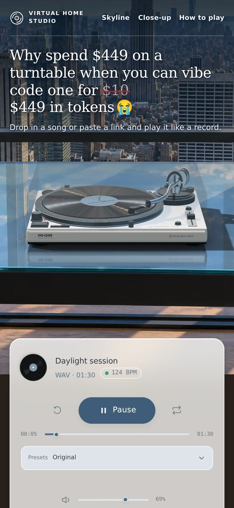

# Virtual Home Studio



**Why spend $449 on a turntable when you can vibe code one for ~~$10~~ $449 in tokens?**

Drop an MP3 or WAV onto the page and the VHS-42069, a fictional direct-drive turntable, plays it like a record: the platter spins up, the arm cues down, and you can scratch, change speed and nudge the pitch. It sits on a glass desk in a sunny Manhattan studio, and your music never leaves your browser.

**[Open the studio](https://dilldylanpickle.github.io/virtual-home-studio/)** · [Run it locally](#run-it-locally) · [Controls](#controls) · [How it works](#how-it-works)

> 100% vibe coded, because I didn't want to buy a turntable for my home lab lol.

## Highlights

- **A room, not a widget.** A live 3D turntable rendered into a photoreal studio. Click the deck (or **Close-up**) and the camera glides in while the dust cover swings open; **Back to studio** closes it again. **Skyline** fades the controls and tilts the view up to the city while the music keeps playing.
- **Plays like the real thing.** 33⅓, 45 and 78 RPM, a pitch fader with ±8% / ±16% range and Quartz lock, a damped cue lever, a tonearm you can drag to any groove, motor spin-up and coast, and scratching with your mouse or finger.
- **Hears the beat.** Every record gets its tempo detected when it loads. The **Trance Gate** pumps or chops the music in time with it, and stays locked through seeks, pauses, scratches and speed changes.
- **Make it yours.** 8 turntable finishes, 18 vinyl colors (clear and smoke included), 19 label colors, and a record condition from Mint to Poor that you can hear: wear, crackle, pops, wow and flutter.
- **Your music stays yours.** Files are decoded and played entirely in your browser. Nothing is uploaded.

| Close-up | Tempo and Trance Gate |
| --- | --- |
|  |  |
| **Skyline** | **Customize** |
|  |  |

<p align="center"></p>

## Controls

**Just play something:** choose (or drop) an MP3 or WAV, press **Play**, and the arm cues itself. Open **How to play** in the app for the full cheat sheet.

### Around the room

| Control | What it does |
| --- | --- |
| Click the deck / **Close-up** | Move in for a top-down view with every control in reach. **← Back to studio** or Escape takes you back |
| **Skyline** | Fade the controls and look out over the city; music keeps playing |
| **Hide controls** | In close-up, slide the listening bar away for a clean view of the deck |
| **Graphics** | In **Turntable details**: Cinematic (default), Balanced or Performance |

### Playing records

| Control | What it does |
| --- | --- |
| **Choose a record** / drag and drop | Load a local MP3 or WAV; **Replace** swaps it, **Eject** lifts it off |
| **Play / Pause** | Cues the arm for you, with the same spin-up and slowdown as the deck's START/STOP |
| Timeline | Hover to preview, click to move the stylus there, drag to scrub |
| Repeat | Play the record again when it ends |
| **Presets** | One click to Slowed + Pitched Down, Sped Up, Nightcore, Hyperpop, Chipmunk and more; the real speed buttons and pitch fader move to match |

### On the deck

| Control | What it does |
| --- | --- |
| POWER | Rotate to turn the deck on or off |
| START / STOP | Spin up or coast the platter |
| 33 / 45 | Choose the speed; latch both for 78 RPM |
| PITCH / TEMPO RANGE / QUARTZ | Slide the speed, switch between ±8% and ±16%, or lock to the exact RPM |
| CUE | Lift the stylus, or lower it gently (it touches down after about a second) |
| Tonearm | Drag it to any groove |
| Vinyl | Drag with the stylus down to scratch; hold still to stop the sound |

### Tempo and Trance Gate

The **BPM chip** next to the track name shows the tempo as it plays, with a confidence dot; click it (or **Presets**) to open Tempo and the Trance Gate.

| Control | What it does |
| --- | --- |
| **Tap the beat** | Tap along to set the tempo yourself when detection gets it wrong |
| **Fix the beat** | Half or double time, an exact BPM, nudge earlier or later, or move the pattern by a beat |
| **Trance Gate** | Pick a style: Push (sidechain pump), Pulse (a chopped throb), Bounce, Breathe, Trance (16th shimmer) or Gallop (triplets), then tweak the steps, rate (1/2 to 1/32, triplets), depth and swell |

The gate never changes the record's speed or pitch. Reverb is coming soon.

### Keyboard

| Key | Action |
| --- | --- |
| Space | Start / stop the platter |
| C | Raise / lower the stylus |
| R | Lift and park the arm |
| G | Trance Gate on / off |
| T | Tap the beat |
| Escape | Close a panel, leave close-up or Skyline |
| Arrows | With the tonearm focused: move through the record (Shift for bigger steps). With the vinyl focused: hold to scratch |

## Your music stays local

> [!NOTE]
> Selected files are decoded and played entirely in your browser; they are never uploaded to GitHub or any other server. The hosted version is a static GitHub Pages site over HTTPS: no account, no backend. GitHub does log visitors' IP addresses for security, so local audio is not the same as anonymous browsing (see [GitHub's data collection disclosure](https://docs.github.com/en/pages/getting-started-with-github-pages/what-is-github-pages#data-collection)).

## Run it locally

You need Python 3.11+, [uv](https://docs.astral.sh/uv/) and a modern browser (Chromium is what the tests use).

```sh
uv sync
uv run python app.py
```

Open **http://127.0.0.1:42069** and stop the server with Ctrl+C. A graphics card helps: the studio is real-time 3D (WebGL 2), and **Graphics → Performance** lightens it on slower machines. Without WebGL, the full turntable still works as an interactive 2D deck.

## Host it on GitHub Pages

The app is plain static files, so Pages can host it as is.

1. In **Settings → Pages**, set **Build and deployment → Source** to **GitHub Actions**.
2. Push to `master`. The included [Pages workflow](.github/workflows/pages.yml) publishes the HTML and `static/` assets only, with every file URL stamped with the commit so browsers never mix cached files from an older deploy.
3. Open `https://<user>.github.io/<repository>/` (keep the trailing slash).

## How it works

- **No build step.** A tiny FastAPI server (or any static host) serves plain HTML, CSS and JavaScript.
- **2.5D studio.** The room, speakers and skyline are a photograph; the turntable is real 3D geometry ([Three.js 0.180.0](static/vendor/THREE-LICENSE.txt), bundled locally) lit, shadowed and reflected to sit on the photo's glass desk. A transparent SVG of the deck keeps every control accessible and clickable.
- **One audio engine.** An AudioWorklet reads the decoded record at the platter's speed, so motor ramps, pitch, scratching, seeking and the cue all share one sound path, plus simulated surface noise, crackle and cartridge tone.
- **Offline tempo analysis.** A Web Worker finds onsets, the tempo and the beat grid once per file and caches the result; the Trance Gate reads that grid at the record's playhead.

The deck and its sound are simulations, not measurements of real hardware.

## Development

```sh
uv sync --group dev
uv run --group dev playwright install chromium
uv run python app.py                                # keep running in another terminal
uv run --group dev python tests/acceptance.py      # browser acceptance checks (needs ffmpeg)
node tests/audio-engine.mjs                         # audio engine DSP checks (needs Node.js)
```

There is no single test runner; [AGENTS.md](AGENTS.md#tests) lists every suite, the architecture and the rules for contributing. [REFERENCE.md](REFERENCE.md) covers the turntable's geometry and simulation assumptions, and [docs/](docs/) holds engineering notes on the audio engine, record handling and direct manipulation.

## License

[MIT](LICENSE). The VHS-42069 and the Virtual Home Studio name and logo are original to this project; Three.js is MIT-licensed by its authors.
